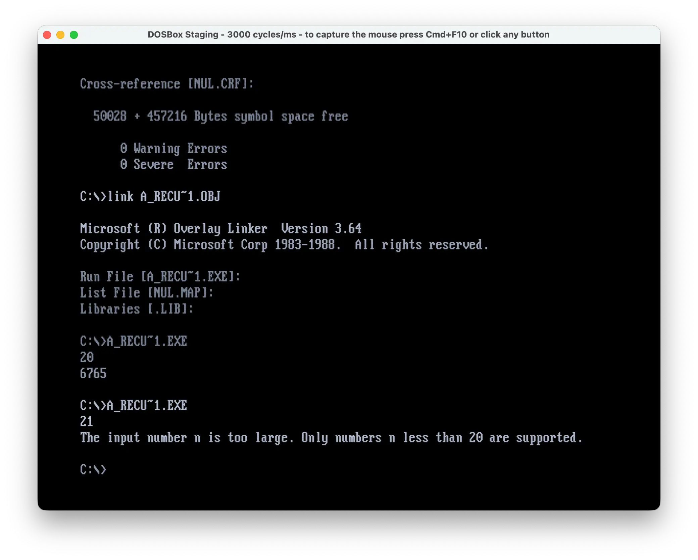
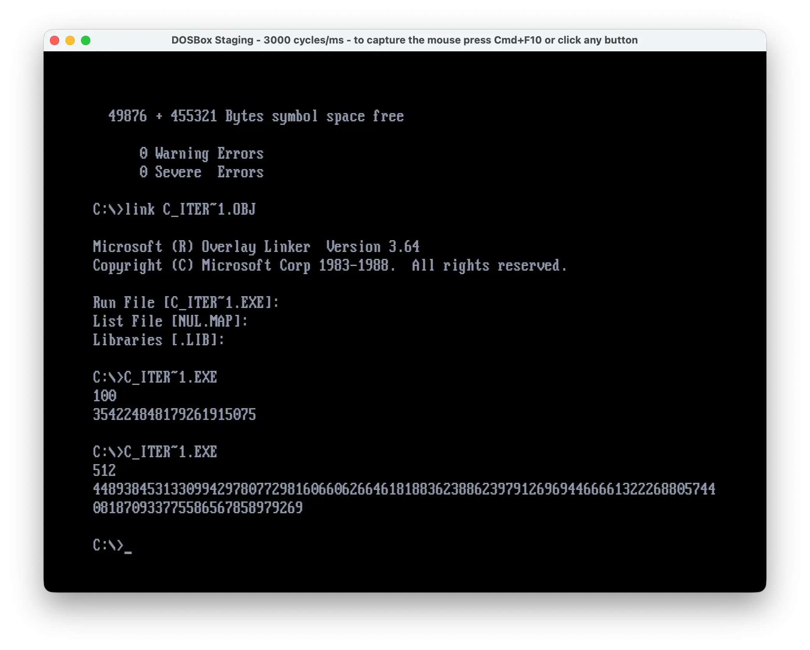

# 05 Recursion

## 递归计算斐波那契数列

1. 先估算栈空间：要算斐波那契数列第 $100$ 项，则需约 $100$ 层递归展开，每层保存三五个寄存器（这里取 $5$），每个寄存器 $2$ 字节，则需约 $1000$ 字节，故设置：
    ```asm
    .stack 400h             ; 1024B 栈空间 
    ```
2. 过程调用除了保存好栈帧，还要用 `push` 保存好所有会用到的寄存器，退出时要尽数 `pop` 完，做到栈平衡、**对上层透明**
3. 写输入时，因为解析输入的个位数数字存放在 `ax`，后面的 `fib` 过程也以 `ax` 为输入，所以当时忽略了输入需要逐字符解析（会循环很多位），忘了第 $31$ 行的
    ```asm
        mov cx, ax          ; 存回去，供下一个数字使用
    ```
    以及第 $35$ 行配套的
    ```asm
        mov ax, cx
    ```
    导致解析不成功。
4. 经过调试，程序成功运行，功能正确。
5. 由于题目所求的斐波那契数列第 $100$ 项递归树展开的状态空间太大，暂时限制在 $20$ 项以内。后面的项的计算详见[迭代法](#迭代计算斐波那契数列)。



## 迭代计算斐波那契数列

1. 由于不需要递归，栈空间只需要常规的 `100h`（$256$ 字节）。
2. 计算过程仅关心最近的两项，与之前的历史项无关。仅设奇、偶两个最近的项，递推公式用 C++ 表示为：
    ```cpp
        fib[i & 1] = fib[0] + fib[1];
    ```
    其中，$i$ 为正在计算的项。
3. 由于第 $100$ 项很大，$16$ 位寄存器无法保存。采用 $512$ 位数据段高精度保存：
    ```asm
        fib0 dq 0,0,0,0,0,0,0,0 ; 64 字节滚动数组存迭代法斐波那契数列，最高支持第 739 项
        fib1 dq 1,0,0,0,0,0,0,0 ; 小端序：fib(1) = 1 应存在地址偏移量为 0 处
    ```
4. 由于奇数项和偶数项的计算只有把「哪个数」加到「哪个数」之间有区别，抽象出**统一的高精度加法**。在加法过程内，使用 $32$ 位寄存器加速运算：
    ```asm
        mov cx, 16
        clc                 ; 清除进位标志以备加法

    add_loop:
        mov eax, [si]
        adc [di], eax       ; 利用并行性，每次加 32 位
        lea si, [si+4]      ; lea 不影响 CF
        lea di, [di+4]
        loop add_loop       ; loop 不影响 CF
    ```
    通过指定 $s$ 和 $d$，来复用上述加法过程：
    ```asm
    fib_even:
        lea si, fib1
        lea di, fib0
        call add_high_precision
        jmp fib_next

    fib_odd:
        lea si, fib0
        lea di, fib1
        call add_high_precision

    fib_next:
    ```
5. 高精度打印中，高精度除法后的高精度**判零**也很有意思，采用 `or` 的方式，把高精度的多个段中的数据全都「叠加」到一个寄存器上，再通过 `test` 判零。同时，采用 $32$ 位寄存器加速运算。
    ```asm
        mov si, bp
        mov cx, 16
        xor eax, eax

    check_zero:             ; 检查商是否已经全零
        or eax, [si]
        add si, 4
        loop check_zero

        test eax, eax
        jnz div_loop        ; 商非零则继续
    ```


